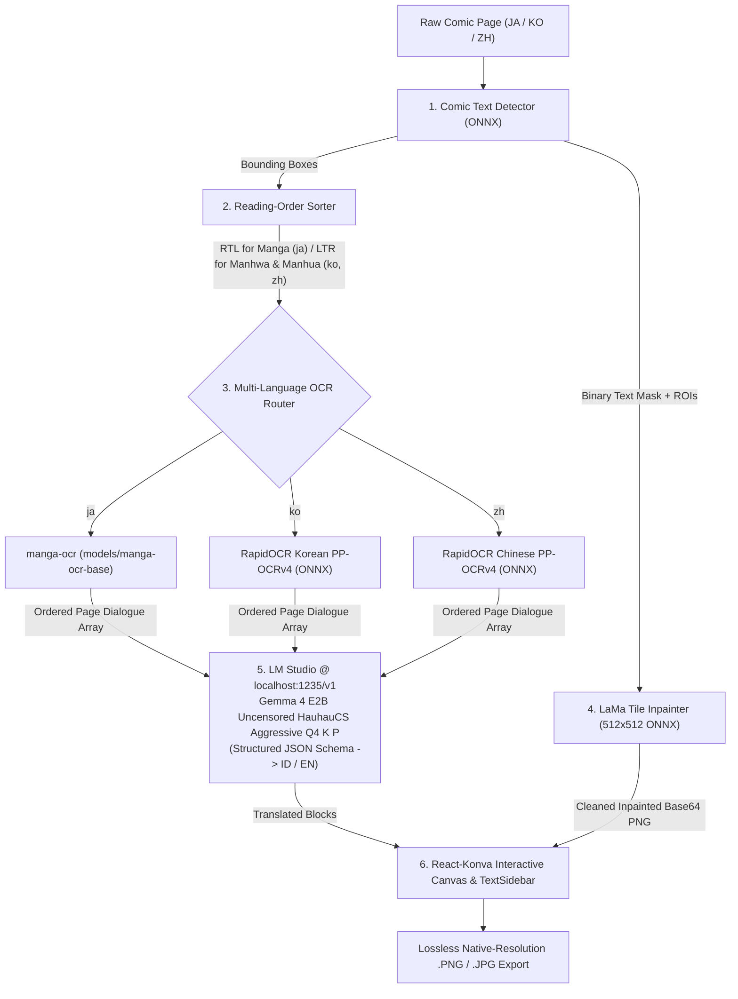

# MangaFlow AI — Local Manga, Manhwa & Manhua Comic Translator

A high-performance, **100% local-first, offline-capable** desktop and web application for translating **Japanese Manga (`ja`)**, **Korean Manhwa (`ko`)**, and **Chinese Manhua (`zh`)** into **Indonesian (`id`)** and **English (`en`)**.

Built with an **ONNX Runtime** computer-vision pipeline, a **Multi-Language OCR Router** (`manga-ocr` + `RapidOCR PP-OCRv4`), **Tile-Based LaMa Inpainting**, **Context-Aware LLM Translation** via **LM Studio** (`localhost:1235`), an interactive **React + Konva** typesetting studio, and standalone Windows desktop packaging via **PyInstaller (`comic-backend.exe`)** + **Tauri Sidecar**.

---

## 1. Multi-Language Pipeline Architecture (`JA` / `KO` / `ZH`)

```text
+-----------------------------------------------------------------------------------+
|                        RAW COMIC PAGE (Manga / Manhwa / Manhua)                   |
+-----------------------------------------+-----------------------------------------+
                                          |
                                          v
+-----------------------------------------------------------------------------------+
|  [STAGE 1] Comic Text Detector (ONNX: models/comictextdetector.pt.onnx)           |
|  - YOLOv5 block detection + DBNet text probability + UNet pixel segmentation      |
|  - Outputs: Bounding Boxes [x1, y1, x2, y2] + Binary Text Mask (H x W, uint8)     |
+--------------------+-----------------------------------------+--------------------+
                     |                                         |
                     v                                         | (Binary Text Mask
+--------------------------------------------------+           |  + Bounding Boxes)
|  [STAGE 2] Comic Reading-Order Bubble Sorter     |           |
|  - Japanese (ja) : Right-to-Left, Top-to-Bottom  |           |
|  - Korean   (ko) : Left-to-Right, Top-to-Bottom  |           |
|  - Chinese  (zh) : Left-to-Right, Top-to-Bottom  |           |
+--------------------+-----------------------------+           |
                     |                                         |
                     v                                         |
+--------------------------------------------------+           |
|  [STAGE 3] Multi-Language OCR Router             |           |
|  - Border-touching bubble outline eraser         |           |
|  - Horizontal multi-line strip segmentation      |           |
|                                                  |           |
|    +-- [ja] --> manga-ocr (VisionEncoderDecoder) |           |
|    |            models/manga-ocr-base/           |           |
|    |            (Vertical tategaki & horizontal) |           |
|    |                                             |           |
|    +-- [ko] --> RapidOCR PP-OCRv4 (ONNX)         |           |
|    |            korean_PP-OCRv4_rec_infer.onnx   |           |
|    |            Multilingual_PP-OCRv3_det.onnx   |           |
|    |                                             |           |
|    +-- [zh] --> RapidOCR PP-OCRv4 (ONNX)         |           |
|                 ch_PP-OCRv4_rec_infer.onnx       |           |
|                 ch_PP-OCRv4_det_infer.onnx       |           |
+--------------------+-----------------------------+           |
                     |                                         v
                     |                        +-------------------------------------+
                     |                        |  [STAGE 4] LaMa Tile Inpainter      |
                     |                        |  (ONNX: models/lama_fp32.onnx)      |
                     |                        |  - 512x512 padded ROI tile crops    |
                     |                        |  - Lossless unmasked pixel patching |
                     |                        |  - Auto session unload to free VRAM |
                     |                        +----------------+--------------------+
                     |                                         |
                     v                                         |
+--------------------------------------------------+           |
|  [STAGE 5] Context-Aware LLM Translation Engine  |           |
|  - LM Studio OpenAI Server @ localhost:1235/v1   |           |
|  - Model: "Gemma 4 E2B Uncensored HauhauCS       |           |
|            Aggressive Q4 K P"                    |           |
|  - Full-page dialogue array translated in a      |           |
|    single prompt with strict JSON Schema output  |           |
|  - Target Languages: Indonesian (id) / English   |           |
+--------------------+-----------------------------+           |
                     |                                         |
                     +--------------------+--------------------+
                                          |
                                          v
+-----------------------------------------------------------------------------------+
|  [STAGE 6] Interactive React-Konva Typesetting Workspace                          |
|  - Layer 1 (Background) : Cleaned LaMa-inpainted page + "Hold to Compare Original"|
|  - Layer 2 (Typography) : Draggable, resizable (Transformer) translated text      |
|                           with real-time font, size, color & white outline stroke |
|  - Layer 3 (UI Overlay) : Selection highlights & handles (excluded during export) |
|  - Full-Resolution Export: 1:1 native dimension .PNG / .JPG composite export      |
+-----------------------------------------------------------------------------------+
```

### Mermaid Flow Diagram



---

## 2. Key Features

- **100% Local & Offline-Capable CV/OCR Pipeline**:
  - Zero external cloud dependencies during translation. Once model weights are verified in `models/` (or `%LOCALAPPDATA%\ComicTranslator\models` in the packaged desktop executable), detection, OCR, and inpainting run completely offline.
- **First-Launch Auto-Downloader with Real-Time SSE Progress (`DownloadModal.jsx`)**:
  - On startup, the app queries `GET /api/models/status`. If any ONNX or OCR weights are missing, a blocking dark-mode modal connects to `GET /api/models/download` (Server-Sent Events) and streams real-time per-file and overall progress bars before unlocking the workspace.
- **Language-Specific OCR Routing & Reading-Order Sorting**:
  - **Japanese (`ja`)**: Right-to-Left (`RTL`) reading-order sort + local `kha-white/manga-ocr-base` transformer supporting vertical *tategaki* and horizontal *yokogaki* dialogue.
  - **Korean (`ko`)**: Left-to-Right (`LTR`) reading-order sort + `RapidOCR` with `korean_PP-OCRv4_rec_infer.onnx` and `Multilingual_PP-OCRv3_det_infer.onnx`.
  - **Chinese (`zh`)**: Left-to-Right (`LTR`) reading-order sort + `RapidOCR` with `ch_PP-OCRv4_rec_infer.onnx` and `ch_PP-OCRv4_det_infer.onnx`.
- **Context-Aware Full-Page Translation via LM Studio**:
  - Sends all speech bubbles on a page in reading order within a single prompt to preserve character voice, pronouns, and scene continuity.
  - Uses strict `response_format: { type: "json_schema" }` with automatic JSON fallback parsing so bubble IDs always map 1:1 back to their bounding boxes.
  - Instant **"Re-translate"** button (`POST /api/retranslate`) to switch between **Indonesian (`id`)** and **English (`en`)** without re-running detection, OCR, or LaMa inpainting.
- **VRAM-Safe Tile-Based LaMa Inpainting**:
  - Crops 32px-padded Regions of Interest around detected text boxes, inpaints them sequentially at `512×512`, composites only the active text mask pixels back onto the original page (keeping unmasked artwork 100% lossless), and unloads the LaMa ONNX session immediately afterward to leave VRAM headroom for LM Studio.
- **Interactive `react-konva` Canvas & Synchronized `TextSidebar`**:
  - Multi-page batch import queue with sequential background processing.
  - Smooth mouse-wheel zoom around the cursor, click-and-drag canvas panning, and a press-and-hold **"Hold to Compare Original"** button.
  - Draggable and 8-anchor resizable (`Konva.Transformer`) text boxes with live word wrapping.
  - Two-way synchronized **TextSidebar** to edit `original_text` (OCR), `translated_text`, font family, font size, alignment, text color, and customizable white halo outline stroke (`fillAfterStrokeEnabled`), plus **"Apply Style to All"**.
  - **Lossless Native-Dimension Export**: Composites the inpainted background layer and Konva typography layer at exact `1:1` original image dimensions into `.PNG` or `.JPG`.
- **Standalone Windows Desktop Packaging**:
  - **PyInstaller Sidecar (`comic-backend.exe`)**: Bundles FastAPI, Uvicorn, ONNX Runtime, RapidOCR, and Manga-OCR into a single executable that stores models persistently in `%LOCALAPPDATA%\ComicTranslator\models`.
  - **Tauri Desktop Shell**: Automatically spawns `comic-backend.exe` silently in the background on startup and terminates the sidecar process cleanly when the window closes.

---

## 3. Directory Structure

```text
Manga/
├── README.md                         # Project documentation & architecture guide
├── start_dev.bat                     # Single-click launcher for FastAPI + Vite dev servers
├── docs/
│   └── SPEC.md                       # Complete system & data contract specification
├── backend/
│   ├── main.py                       # FastAPI server entry point (port 8000)
│   ├── requirements.txt              # Python backend dependencies
│   ├── core/
│   │   ├── model_manager.py          # Offline verification & Hugging Face SSE downloader
│   │   ├── detector.py               # Comic Text Detector ONNX + reading-order sorter
│   │   ├── ocr.py                    # Multi-language OCR router (manga-ocr + RapidOCR)
│   │   ├── inpainter.py              # Tile-based LaMa ONNX inpainter (512x512 ROI)
│   │   └── translator.py             # LM Studio OpenAI client + Structured JSON Schema
│   ├── generate_samples.py           # Synthetic comic page generator (JA / KO / ZH)
│   ├── test_models.py                # Model download & offline cache verification test
│   ├── test_pipeline.py              # Full CV/OCR/Inpaint/LLM pipeline test suite
│   └── test_api.py                   # Live HTTP & SSE FastAPI endpoint test suite
├── frontend/
│   ├── package.json                  # React 19, Vite 8, Tailwind CSS 3, react-konva, Tauri CLI
│   ├── vite.config.js                # Vite configuration (port 5173 + /api proxy)
│   ├── tailwind.config.js            # Dark-mode Tailwind CSS configuration
│   ├── src/
│   │   ├── App.jsx                   # Startup check, batch queue & workspace coordinator
│   │   ├── components/
│   │   │   ├── DownloadModal.jsx     # First-launch blocking SSE model progress modal
│   │   │   ├── Toolbar.jsx           # Batch import, LM Studio badge, language & export bar
│   │   │   ├── MangaCanvas.jsx       # 3-layer react-konva editor & native 1:1 exporter
│   │   │   └── TextSidebar.jsx       # Synchronized OCR/translation & typography inspector
│   └── src-tauri/                    # Tauri desktop host & comic-backend.exe sidecar runner
│       ├── Cargo.toml
│       ├── tauri.conf.json
│       ├── capabilities/
│       │   └── default.json
│       ├── binaries/
│       │   └── comic-backend-x86_64-pc-windows-msvc.exe
│       └── src/
│           └── main.rs               # Spawns comic-backend sidecar on launch & kills on exit
├── models/                           # Local development model weights directory
├── samples/                          # Sample comic pages (sample_ja.jpg, sample_ko.jpg, sample_zh.jpg)
└── packaging/
    ├── comic-backend.spec            # PyInstaller one-file spec for comic-backend.exe
    ├── build_backend.py              # Automated PyInstaller build & persistent cache seeder
    ├── build_backend.bat             # Windows batch wrapper for building comic-backend.exe
    └── pyinstaller/
        └── backend.spec              # Spec alias matching SPEC.md
```

---

## 4. LM Studio Setup Instructions (Port `1235`)

The translation engine connects to **LM Studio** running a local OpenAI-compatible HTTP server on port **`1235`**.

1. **Install & Open LM Studio**:
   - Download and install [LM Studio](https://lmstudio.ai/).
2. **Download & Load the Target Model**:
   - Search for and download:
     ```text
     Gemma 4 E2B Uncensored HauhauCS Aggressive Q4 K P
     ```
     *(Slug identifier in LM Studio: `gemma-4-e2b-uncensored-hauhaucs-aggressive`)*
   - Load the model into memory in LM Studio.
3. **Configure the Local Server on Port `1235`**:
   - Open the **Developer / Local Server** tab in LM Studio.
   - Set **Server Port** to **`1235`** (`http://localhost:1235/v1`).
   - Enable **CORS (Cross-Origin Resource Sharing)**.
   - Click **Start Server**.
4. **Verify Connection**:
   - The top toolbar in MangaFlow AI polls `GET http://localhost:8000/api/lmstudio/status` automatically and displays a green pulsing indicator:
     ```text
     localhost:1235 • Gemma 4 E2B
     ```

---

## 5. Development Quickstart

### Option A: One-Click Launcher (`start_dev.bat`)

Double-click **`start_dev.bat`** in the root `Manga/` folder (or run it from a terminal):

```bat
start_dev.bat
```

This automatically starts:
- **FastAPI Backend**: `http://localhost:8000`
- **React + Vite Frontend**: `http://127.0.0.1:5173`

### Option B: Manual Terminal Launch

#### 1. Backend (FastAPI on Port 8000)
```powershell
cd "c:\FILE PROYEKAN\Manga"
.\backend\venv\Scripts\python.exe backend\main.py
```

#### 2. Frontend (React + Vite on Port 5173)
```powershell
cd "c:\FILE PROYEKAN\Manga\frontend"
npm run dev
```

---

## 6. Building the Standalone Windows Application (`.exe`)

### Step 1: Build the PyInstaller Backend Sidecar (`comic-backend.exe`)

Run the automated PyInstaller packaging script to bundle `backend/main.py`, ONNX Runtime, RapidOCR, and Manga-OCR into `packaging/dist/comic-backend.exe`:

```powershell
cd "c:\FILE PROYEKAN\Manga"
.\backend\venv\Scripts\python.exe packaging\build_backend.py
```

- **Output Binary**: `packaging/dist/comic-backend.exe` (and `packaging/comic-backend.exe`).
- **Persistent Model Storage**: When running as a frozen executable (`comic-backend.exe`), `ModelManager` automatically resolves the model directory to:
  ```text
  %LOCALAPPDATA%\ComicTranslator\models
  ```
  so weights downloaded on first launch persist permanently across app updates and restarts.

### Step 2: Build the Tauri Desktop Application (`npm run tauri build`)

Inside `frontend/`, build the native Windows desktop executable (which embeds the compiled React frontend and bundles `comic-backend.exe` as a managed Tauri Sidecar Process):

```powershell
cd "c:\FILE PROYEKAN\Manga\frontend"
npm run tauri build
```

- On launch, the Tauri desktop host spawns `comic-backend.exe` silently with `CREATE_NO_WINDOW`.
- On window close (`WindowEvent::CloseRequested` / `RunEvent::Exit`), Tauri terminates the `comic-backend.exe` sidecar process tree cleanly so no orphan process remains on port `8000`.

---

## 7. Automated Verification & Test Suites

Run the end-to-end verification suites with the backend virtual environment:

```powershell
# 1. Verify local ONNX & OCR model weights and 100% offline cache resolution
.\backend\venv\Scripts\python.exe backend\test_models.py

# 2. Verify full CV -> OCR -> LaMa Tile Inpainting -> LM Studio Translation pipeline (JA / KO / ZH)
.\backend\venv\Scripts\python.exe backend\test_pipeline.py

# 3. Verify live FastAPI HTTP & SSE endpoints (/api/models/status, /api/lmstudio/status, /api/process-page, /api/retranslate)
.\backend\venv\Scripts\python.exe backend\test_api.py
```
