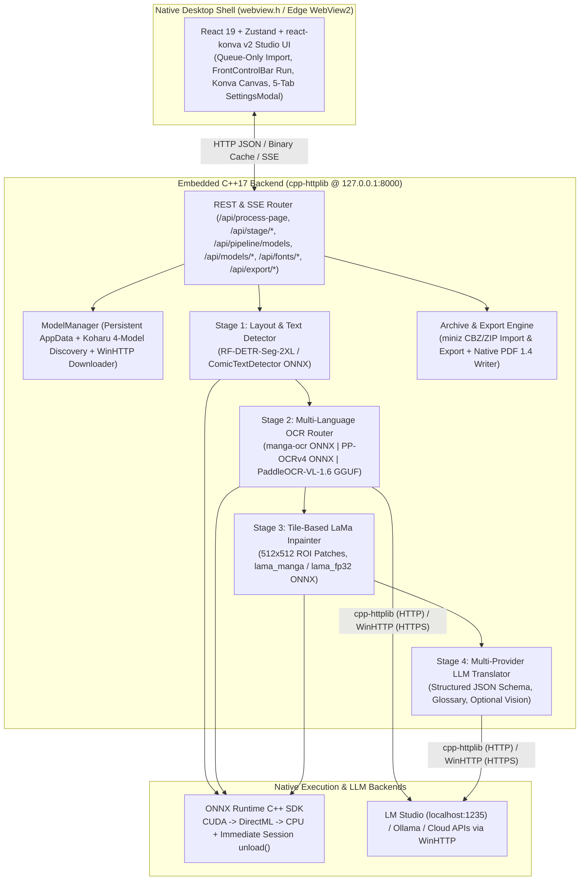

# Vellum - Pure Native C++17 + React Manga, Manhwa & Manhua Translator Studio

[](backend-cpp/CMakeLists.txt)
[](backend-cpp/src/pipeline/model_manager.cpp)
[](frontend/package.json)
[](packaging/build_cpp_release.bat)

A **local & offline** native Windows desktop studio for detecting, OCR-ing, inpainting, translating, and typesetting **Japanese Manga (`ja`)**, **Korean Manhwa (`ko`)**, and **Chinese Manhua (`zh`)** into **16 target languages** (including Indonesian, English, and more).

Built with a **pure modern C++17 native desktop backend** (`cpp-httplib` + `webview.h` Edge WebView2 + ONNX Runtime C++ SDK) paired with an interactive **React 19 + Zustand + `react-konva` v2 typesetting studio** — delivering **<1s cold startup**, **~20.5 MB standalone disk footprint (~7.7 MB `.zip`)**, and **<100 MB idle backend RAM** with zero Python, PyTorch, OpenCV, Tauri/Rust, or Electron runtime bloat.

---

## 1. Architecture Overview

`Vellum.exe` runs as a single zero-console Win32 executable that hosts an embedded multithreaded `cpp-httplib` backend alongside a native Microsoft Edge WebView2 desktop window rendering the compiled React/Konva v2 studio UI.

```text
+======================================================================================+
|                     Vellum.exe (Native Win32 C++17 Desktop Host)                     |
+======================================================================================+
|                                                                                      |
|  +--------------------------------------------------------------------------------+  |
|  |  Native Desktop Window (`webview.h` / Microsoft Edge WebView2)                 |  |
|  |  React 19 + Zustand + Tailwind CSS + `react-konva` v2 Studio UI                |  |
|  |  - MenuBar, FrontControlBar (Scope, Stages, Model, Manual Run), StatusBar      |  |
|  |  - Queue-Only Page / Folder / CBZ / ZIP Import (zero unwanted auto-processing) |  |
|  |  - 5-Tab SettingsModal with Live Pipeline Model Selector & Koharu Importer     |  |
|  |  - 3-Layer Konva Canvas + Synchronized TextSidebar & Font Manager              |  |
|  +---------------------------------------+----------------------------------------+  |
|                                          | HTTP / SSE (`127.0.0.1:8000`)             |
|                                          v                                           |
|  +--------------------------------------------------------------------------------+  |
|  |  Embedded Local Backend (`cpp-httplib` + `nlohmann/json`)                      |  |
|  |  - Serves `frontend/dist` at `/` and REST + SSE endpoints at `/api/*`          |  |
|  |  - Zero-Base64 Disk Image Cache (`/api/cache/images/{id}.png`)                 |  |
|  |  - Persistent Settings (`%LOCALAPPDATA%\ComicTranslator\settings.json`)        |  |
|  |  - Local / System / Google Fonts Manager + `miniz` CBZ/ZIP & Native PDF 1.4    |  |
|  +----+------------------------+-------------------------+--------------------+---+  |
|       |                        |                         |                    |      |
|       v                        v                         v                    v      |
|  +-------------------+  +---------------------+  +--------------------+  +---------+ |
|  | Stage 1: Detector |  | Stage 2: OCR Router |  | Stage 3: Inpainter |  | Stage 4 | |
|  | ONNX Runtime C++  |  | ONNX Runtime C++ /  |  | ONNX Runtime C++   |  | LLM API | |
|  |                   |  | Vision-Language LLM |  |                    |  |         | |
|  | Selectable:       |  | Selectable:         |  | Selectable:        |  | Local:  | |
|  | - Koharu RF-DETR  |  | - Auto Router       |  | - lama_manga.onnx  |  | cpp-    | |
|  |   Seg-2XL (1152)  |  | - manga-ocr (JA)    |  |   (screentone LaMa)|  | httplib | |
|  | - ComicTextDetect |  | - RapidOCR PP-OCRv4 |  | - lama_fp32.onnx   |  |         | |
|  |                   |  |   (KO / ZH)         |  |                    |  | Cloud:  | |
|  | RTL(ja)/LTR(ko,zh)|  | - PaddleOCR-VL-1.6  |  | 512x512 ROI Tiles  |  | WinHTTP | |
|  | + Binary Mask     |  |   GGUF (LM Studio)  |  | Lossless Composite |  | (TLS)   | |
|  +--------+----------+  +----------+----------+  +---------+----------+  +----+----+ |
|           \________________________|_______________________/                  |      |
|                                    v                                          v      |
|          +--------------------------------------------------+   +-----------------+  |
|          | Hardware-Agnostic ONNX Runtime C++ Session Pool  |   | 8 LLM Providers |  |
|          | CUDA -> DirectML (D3D12) -> CPU + Auto `unload()`|   | LM Studio :1235 |  |
|          | Zero OpenCV (`stb_image` / `stb_image_write`)    |   | Ollama, OpenAI, |  |
|          +--------------------------------------------------+   | Gemini, Claude, |  |
|                                                                 | DeepSeek, etc.  |  |
|                                                                 +-----------------+  |
+======================================================================================+
```

### Mermaid System Diagram



---

## 2. Footprint & Performance

Measured on Windows x64 (`Release` build with MSVC `/O2 /GL /LTCG /OPT:REF /OPT:ICF`):

| Metric | C++17 Native (`Vellum`) |
| :--- | :--- |
| **Root One-Click Launcher (`Vellum.exe`)** | **~170 KB** (zero-console Win32 launcher) |
| **Standalone Bundle (`Vellum/`)** | **~20.5 MB** (`2.21 MB` exe + `16.55 MB` ORT DirectML DLLs + `1.79 MB` React UI) |
| **GitHub Release Archive (`.zip`)** | **~7.7 MB** (`Vellum-Windows-x64.zip`) |
| **Idle Backend Memory (RAM)** | **~37 MB Working Set** (`< 100 MB` idle) |
| **Cold Launch to Native Window** | **< 1 s** (`~0.66 s`, zero console window flash) |
| **VRAM / Model Memory Lifecycle** | Lazy `Ort::Session` creation + immediate `unload()` after every stage |
| **CV / Image / Archive Dependencies** | Header-only `stb_image`, `miniz`, native PDF 1.4 writer (zero OpenCV / Python) |
| **GPU Acceleration** | ONNX Runtime C++ (`CUDA` → `DirectML` → `CPU` auto-fallback) |

---

## 3. Key Features

- **Queue-Only Import & Manual Run Workflow**:
  - Drag-and-drop or import individual images, folders, or `.cbz`/`.zip` archives directly into the page queue without triggering unwanted automatic processing.
  - Select execution **Scope** (`Current Page`, `Selected Pages`, or full `Project`), toggle any combination of **Pipeline Stages** (`Detect`, `OCR`, `Inpaint`, `Translate`), choose active **LLM Model** and **Source → Target Languages** in `FrontControlBar`, and click **Run** when ready.
- **Interactive Pipeline Model Selector (`Settings → Pipeline`)**:
  - Inspect live `Ready` / `Not Installed` availability badges via `GET /api/pipeline/models` and switch models per stage without editing config files:
    - **Detection**: `Koharu RF-DETR-Seg-2XL (1152)` (layout & text segmentation) or `ComicTextDetector` (`comictextdetector.pt.onnx`), with optional confidence/box threshold overrides and reading-order sorting (`RTL` for `ja`, `LTR` for `ko`/`zh`).
    - **OCR**: `Auto` router (`manga-ocr` ONNX for `ja`, `RapidOCR PP-OCRv4` ONNX for `ko`/`zh`), explicit `manga-ocr`, `RapidOCR`, or `PaddleOCR-VL-1.6 (GGUF via LM Studio)`.
    - **Inpainting**: `lama_manga.onnx` (screentone-tuned manga LaMa) or `lama_fp32.onnx`, running `512×512` padded ROI tiles with lossless compositing.
  - One-click **Import Local Koharu Models** (`POST /api/models/import-koharu`) and toggleable **Auto GPU/CPU** vs **CPU Only** execution mode + **Auto-Unload VRAM**.
- **Multi-Provider Context-Aware LLM Translation (8 Providers, 16 Target Languages)**:
  - Connects to local **LM Studio** (`http://localhost:1235/v1`) and **Ollama** (`http://localhost:11434/v1`) via `cpp-httplib`, or cloud APIs (**OpenAI**, **Google Gemini**, **Anthropic Claude**, **DeepSeek**, **OpenRouter**, **Custom OpenAI-Compatible**) via native Windows **WinHTTP TLS**.
  - Enforces Structured JSON Schema output, supports **custom instructions**, **glossary terms**, **reasoning effort** controls with O(N) C++ `<think>...</think>` stripping, and optional **multimodal page-image Vision context** with automatic text-only fallback.
- **Interactive React 19 + `react-konva` v2 Typesetting Studio**:
  - 3-layer Konva canvas (inpainted artwork, draggable/resizable text boxes, manual bubble drawing & mask tools), mouse-wheel zoom/pan, and press-and-hold **Compare Original**.
  - Multi-page `.cbz` / native `.pdf` / lossless `.png` & `.jpg` export.
  - Integrated **Font Manager** (local `.ttf`/`.otf` uploads, Windows system fonts, and curated one-click Google Fonts downloader with ordered fallback chain) persisted in `%LOCALAPPDATA%\ComicTranslator\fonts`.

---

## 4. Quickstart Guide

### A. For End-Users (Windows x64 — Zero Setup)

1. **Download the Release Archive**:
   - Download **`Vellum-Windows-x64.zip`** (~7.7 MB) from **GitHub Releases**.
2. **Extract & Launch**:
   - Extract `Vellum-Windows-x64.zip` anywhere on your PC.
   - Open `Vellum/` and double-click **`Vellum.exe`** (or double-click root **`Vellum.exe`** when built locally).
   - The native desktop studio opens immediately (`<1s`) with zero terminal window or external browser required. *(Requires Windows 10/11 x64 with Microsoft Edge WebView2 Runtime, pre-installed on modern Windows.)*
3. **First-Launch & Local `models/` Setup**:
   - Place ONNX model weights directly in the local **`models/`** folder beside `Vellum.exe` (or let Vellum manage them in `%LOCALAPPDATA%\ComicTranslator\models`; you can also override via `MANGA_MODELS_DIR`).
   - Expected `models/` layout:
     ```text
     models/
     ├── koharu-layout-rfdetr-seg-2xl-1152.onnx   # Stage 1: RF-DETR-Seg-2XL detector (recommended)
     ├── comictextdetector.pt.onnx                # Stage 1: ComicTextDetector fallback
     ├── lama_manga.onnx                          # Stage 3: Screentone-tuned manga LaMa inpainter
     ├── lama_fp32.onnx                           # Stage 3: Standard LaMa inpainter fallback
     ├── manga-ocr/
     │   ├── encoder_model.onnx                   # Stage 2: Japanese Manga OCR encoder
     │   ├── decoder_model.onnx                   # Stage 2: Japanese Manga OCR decoder
     │   └── vocab.txt
     ├── rapidocr/
     │   ├── ch_PP-OCRv4_det_infer.onnx           # Stage 2: Chinese/Korean PP-OCRv4 detector
     │   ├── ch_PP-OCRv4_rec_infer.onnx           # Stage 2: Chinese PP-OCRv4 recognizer
     │   └── korean_PP-OCRv4_rec_infer.onnx       # Stage 2: Korean PP-OCRv4 recognizer
     └── paddleocr-vl-gguf/                       # Optional: PaddleOCR-VL-1.6 GGUF for LM Studio
     ```
   - If any ONNX weights are missing on first launch, the built-in **DownloadModal** streams them automatically from Hugging Face with real-time progress bars (or detects any existing local Koharu model cache).
4. **Connect LM Studio (Port `1235`) or Cloud Provider**:
   - **Recommended Local Setup (LM Studio)**: Load a model (e.g., `Gemma 4 E2B Uncensored HauhauCS Aggressive Q4 K P`), start LM Studio's Local Server on port **`1235`**, and enable **CORS**.
   - **Or use Ollama / Cloud APIs**: Open **Settings → Providers** to configure Ollama, OpenAI, Gemini, Anthropic, DeepSeek, OpenRouter, or any custom OpenAI-compatible endpoint.

---

### B. For Developers (Building from Source with CMake + MSVC)

#### Prerequisites
- **Windows 10 / 11 (x64)**
- **Visual Studio 2022** (or **Visual Studio 2022 Build Tools**) with the **Desktop development with C++** workload (MSVC v143 + Windows SDK + CMake Tools)
- **Node.js 18+** & `npm`

All C++ third-party dependencies (`cpp-httplib`, `nlohmann/json`, `webview/webview`, `Microsoft.Web.WebView2`, official prebuilt `ONNX Runtime DirectML win-x64`, `miniz`, `stb`) are fetched automatically by CMake `FetchContent` — **no vcpkg, Python, or Rust required**.

#### Option 1: One-Command Release Build (Recommended)

```bat
packaging\build_cpp_release.bat
```

This script automatically:
1. Runs `npm run build` inside `frontend/` to compile `frontend/dist`.
2. Configures and compiles `backend-cpp` in `Release` mode with MSVC `/O2 /GL /LTCG /OPT:REF /OPT:ICF`.
3. Stages `Vellum.exe`, ONNX Runtime DLLs, and `frontend/dist` into `Vellum/` and installs the zero-console one-click root launcher **`Vellum.exe`**.
4. Packages a clean GitHub Releases archive at **`release/Vellum-Windows-x64.zip`**.

After building, double-click **`Vellum.exe`** in the repository root.

#### Option 2: Hot-Reload UI Development (`start_dev.bat`)

Once `backend-cpp` is compiled, run:

```bat
start_dev.bat
```

This starts the native C++17 backend in headless HTTP mode (`Vellum.exe --headless` on `http://127.0.0.1:8000`) alongside the React + Vite HMR dev server (`http://127.0.0.1:5173`, proxying `/api/*` to port `8000`).

#### Option 3: Manual CMake Build

```powershell
# 1. Compile the React v2 frontend bundle
cd frontend
npm install
npm run build
cd ..

# 2. Configure & build the C++17 native desktop app in Release mode
cd backend-cpp
cmake -B build -A x64 -DCMAKE_BUILD_TYPE=Release
cmake --build build --config Release --parallel

# Optional: switch ONNX Runtime backend (DIRECTML [default], CUDA, or CPU)
# cmake -B build -A x64 -DMANGAFLOW_ORT_BACKEND=CUDA -DCMAKE_BUILD_TYPE=Release
```

Developer runtime flags on `Vellum.exe`:
- `--headless` (or `MANGAFLOW_HEADLESS=1`): Run pure HTTP/API server without opening a GUI window (useful for Vite HMR dev mode or automated API testing).
- `MANGAFLOW_DEBUG=1`: Enable Edge WebView2 DevTools (`F12`).
- `MANGAFLOW_PORT=8000`: Override default local HTTP port (falls back automatically to a free loopback port if busy).
- `MANGA_MODELS_DIR=<path>`: Override persistent model directory (defaults to `%LOCALAPPDATA%\ComicTranslator\models`).

---

### C. Local Koharu Model Cache Auto-Import

If you already have **Koharu** installed locally, Vellum's `ModelManager` automatically discovers all 4 Koharu Hugging Face snapshots (`<cache_root>/<repo>/snapshots/<hash>/`) with zero redundant downloads:

| Koharu Cache Folder | Role in Vellum | Target Export in `%LOCALAPPDATA%\ComicTranslator\models` |
| :--- | :--- | :--- |
| `mayocream--koharu-layout-rfdetr-seg-2xl-1152` | Primary layout & text segmentation detector | `koharu-layout-rfdetr-seg-2xl-1152.onnx` |
| `mayocream--lama-manga` | Screentone-tuned manga LaMa inpainter | `lama_manga.onnx` (DirectML/CUDA/CPU safe) |
| `mayocream--manga-ocr` | Japanese ViT + BERT Manga OCR | `manga-ocr/encoder_model.onnx`, `decoder_model.onnx`, `vocab.txt` |
| `PaddlePaddle--PaddleOCR-VL-1.6-GGUF` | Vision-Language OCR GGUF (for LM Studio) | `paddleocr-vl-gguf/*.gguf` |

- **Custom Cache Path**: Set `KOHARU_HF_CACHE` (or `KOHARU_MODELS_DIR`) if your Koharu Hugging Face cache is in a custom directory.
- **Optional `.safetensors` → `.onnx` CLI Helper**: If your local Koharu cache only stores PyTorch `.safetensors` weights, an optional standalone CLI converter is provided in `packaging/convert_koharu_to_onnx.py` (requires any external Python 3 environment with `torch`, `safetensors`, `onnx`, `transformers`, and `timm`):
  ```bat
  packaging\convert_koharu_to_onnx.bat
  ```
- **No Koharu Installed?** No action needed — Vellum automatically downloads standard ONNX models via `GET /api/models/download` on first launch.

---

## 5. LM Studio Setup (Port `1235`) & Supported LLM Providers

1. Install [LM Studio](https://lmstudio.ai/) and download a local translation model (default preset: `Gemma 4 E2B Uncensored HauhauCS Aggressive Q4 K P`, slug `gemma-4-e2b-uncensored-hauhaucs-aggressive`).
2. Load the model, open **Developer / Local Server**, set **Server Port** to **`1235`**, enable **CORS**, and click **Start Server**.
3. Vellum automatically connects to `http://localhost:1235/v1` and verifies availability via `GET /api/lmstudio/status`.

All 8 built-in translation providers (configurable in **Settings → Providers**):

| Provider ID | Default Endpoint | Transport | Notes |
| :--- | :--- | :--- | :--- |
| `lmstudio` | `http://localhost:1235/v1` | `cpp-httplib` | Default local provider, fuzzy model matching, JSON Schema |
| `ollama` | `http://localhost:11434/v1` | `cpp-httplib` | Local OpenAI-compatible server |
| `openai` | `https://api.openai.com/v1` | WinHTTP TLS | GPT-4o / GPT-4.1 / reasoning models |
| `gemini` | `https://generativelanguage.googleapis.com/v1beta/openai` | WinHTTP TLS | Gemini 2.5 Flash / Pro |
| `anthropic` | `https://api.anthropic.com/v1` | WinHTTP TLS | Native Anthropic Messages API (`2023-06-01`) |
| `deepseek` | `https://api.deepseek.com/v1` | WinHTTP TLS | DeepSeek Chat / Reasoner |
| `openrouter` | `https://openrouter.ai/api/v1` | WinHTTP TLS | Multi-model routing with Vision & JSON Schema |
| `custom` | User-defined URL | `cpp-httplib` / WinHTTP | Any self-hosted or cloud OpenAI-compatible API |

---

## 6. Repository Structure

```text
Manga/
├── README.md                              # Architecture, benchmarks & quickstart
├── .gitignore                             # Excludes builds, node_modules, models, fonts & binaries
├── start_dev.bat                          # Pure C++17 (--headless) + React Vite HMR dev launcher
├── docs/
│   └── SPEC.md                            # System specification & JSON API contracts
├── backend-cpp/                           # Native C++17 Backend & Edge WebView2 Desktop Host
│   ├── CMakeLists.txt                     # Zero-vcpkg CMake + FetchContent (MSVC /O2 /GL /LTCG)
│   └── src/
│       ├── main.cpp                       # Embedded cpp-httplib server + Edge WebView2 host
│       ├── launcher.cpp                   # Zero-dependency root Win32 one-click launcher
│       ├── app.rc.in                      # Embedded Windows icon & VS_VERSION_INFO resource
│       ├── settings_manager.{hpp,cpp}     # Persistent AppData settings & provider presets
│       ├── font_manager.{hpp,cpp}         # Local, system & Google Fonts catalog manager
│       ├── exporter.{hpp,cpp}             # miniz CBZ/ZIP import/export & native PDF 1.4 writer
│       ├── utils.hpp                      # UTF-8, atomic I/O, Base64 & Windows helpers
│       └── pipeline/
│           ├── model_manager.{hpp,cpp}    # AppData cache, Koharu auto-discovery, ORT session factory
│           ├── detector.{hpp,cpp}         # RF-DETR-Seg-2XL / ComicTextDetector ONNX + RTL/LTR sort
│           ├── ocr.{hpp,cpp}              # manga-ocr ONNX (JA), RapidOCR PP-OCRv4 (KO/ZH) & VLM OCR
│           ├── inpainter.{hpp,cpp}        # 512x512 tile-based LaMa ONNX inpainter
│           └── translator.{hpp,cpp}       # 8-provider LLM client (cpp-httplib + WinHTTP TLS)
├── frontend/                              # React 19 + Zustand + Tailwind + react-konva v2 Studio UI
│   ├── package.json
│   ├── vite.config.js
│   └── src/
│       ├── App.jsx                        # Studio workspace, queue-only import & stage orchestration
│       ├── store/useEditorStore.js        # Centralized studio, pipeline & batch queue state
│       └── components/
│           ├── MangaCanvas.jsx            # 3-layer interactive Konva canvas & 1:1 exporter
│           ├── TextSidebar.jsx            # Dialogue OCR/translation & typography inspector
│           ├── FrontControlBar.jsx        # Model selector, scope, stage toggles, languages & Run
│           ├── MenuBar.jsx                # File/import/export & workspace menu
│           ├── StatusBar.jsx              # Provider, hardware EP & queue status bar
│           ├── SettingsModal.jsx          # 5-tab settings (Appearance, Pipeline, Providers, Translation, Typesetting)
│           ├── DownloadModal.jsx          # First-launch SSE model download modal
│           └── Toolbar.jsx                # Canvas tools & zoom controls
├── packaging/
│   ├── build_cpp_release.bat              # Automated C++17 Release & GitHub .zip builder
│   ├── convert_koharu_to_onnx.{bat,py}    # Optional standalone CLI bridge (.safetensors -> ONNX/GGUF)
│   └── icon.ico                           # Application icon embedded into native binaries
└── samples/                               # Sample JA / KO / ZH comic test pages
```
