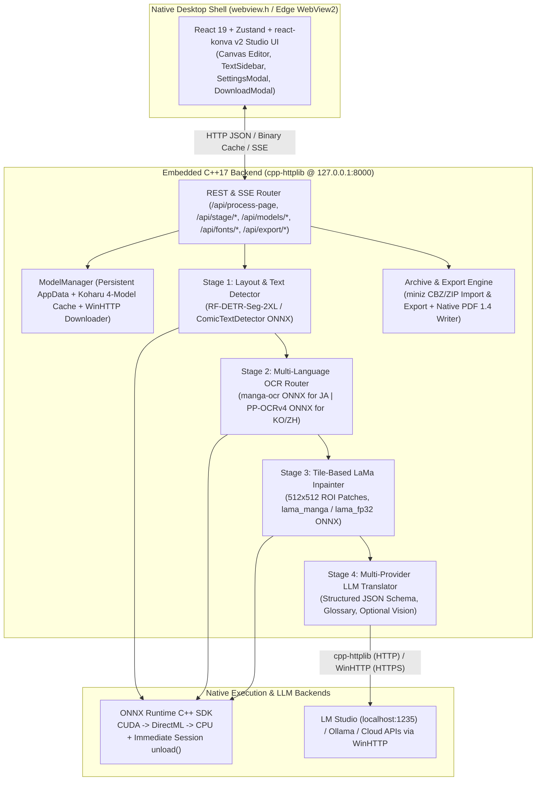

# MangaFlow AI — Native C++17 Manga, Manhwa & Manhua Translator Studio

[](backend-cpp/CMakeLists.txt)
[](backend-cpp/src/pipeline/model_manager.cpp)
[](frontend/package.json)
[](packaging/build_cpp_release.bat)

A **100% local-first, offline-capable** native Windows desktop studio for detecting, OCR-ing, inpainting, translating, and typesetting **Japanese Manga (`ja`)**, **Korean Manhwa (`ko`)**, and **Chinese Manhua (`zh`)** into **16 target languages** (including Indonesian, English, and more).

Re-architected from a Python prototype into a **modern C++17 native desktop application** (`cpp-httplib` + `webview.h` Edge WebView2 + ONNX Runtime C++ SDK) paired with an interactive **React 19 + Zustand + `react-konva` v2 typesetting studio** — delivering **<1s cold startup**, **~20 MB standalone disk footprint (~7.6 MB `.zip`)**, and **<100 MB idle backend RAM** with zero Python, PyTorch, OpenCV, or Electron overhead.

---

## 1. Architecture Overview

`MangaFlow-Cpp.exe` runs as a single zero-console Win32 executable that hosts an embedded multithreaded `cpp-httplib` backend alongside a native Microsoft Edge WebView2 desktop window rendering the compiled React/Konva v2 studio UI.

```text
+======================================================================================+
|                   MangaFlow-Cpp.exe (Native Win32 C++17 Desktop Host)                |
+======================================================================================+
|                                                                                      |
|  +--------------------------------------------------------------------------------+  |
|  |  Native Desktop Window (`webview.h` / Microsoft Edge WebView2)                 |  |
|  |  React 19 + Zustand + Tailwind CSS + `react-konva` v2 Studio UI                |  |
|  |  - MenuBar, FrontControlBar, StatusBar, SettingsModal, DownloadModal (SSE)     |  |
|  |  - 3-Layer Konva Canvas: Inpainted Page, Draggable/Resizable Text, Mask Tools  |  |
|  |  - Synchronized TextSidebar: OCR/Translation Editor, Fonts, Outlines & Batch   |  |
|  +---------------------------------------+----------------------------------------+  |
|                                          | HTTP / SSE (`127.0.0.1:8000`)             |
|                                          v                                           |
|  +--------------------------------------------------------------------------------+  |
|  |  Embedded Local Backend (`cpp-httplib` + `nlohmann/json`)                      |  |
|  |  - Serves `frontend/dist` at `/` and REST + SSE endpoints at `/api/*`          |  |
|  |  - Zero-Base64 Disk Image Cache (`/api/cache/images/{id}.png`)                 |  |
|  |  - Persistent Settings (`%LOCALAPPDATA%\ComicTranslator\settings.json`)        |  |
|  |  - Local / System / Google Fonts Manager + `miniz` CBZ/ZIP & Native PDF 1.4    |  |
|  +----+------------------------+-------------------------+--------------------+---+  |
|       |                        |                         |                    |      |
|       v                        v                         v                    v      |
|  +-------------------+  +---------------------+  +--------------------+  +---------+ |
|  | Stage 1: Detector |  | Stage 2: OCR Router |  | Stage 3: Inpainter |  | Stage 4 | |
|  | ONNX Runtime C++  |  | ONNX Runtime C++    |  | ONNX Runtime C++   |  | LLM API | |
|  |                   |  |                     |  |                    |  |         | |
|  | Primary:          |  | [ja] manga-ocr ONNX |  | Primary:           |  | Local:  | |
|  |  Koharu RF-DETR   |  |  ViT Enc + BERT Dec |  |  lama_manga.onnx   |  | cpp-    | |
|  |  Seg-2XL (1152)   |  |  + vocab.txt        |  |  (screentone LaMa) |  | httplib | |
|  | Fallback:         |  | [ko] RapidOCR       |  | Fallback:          |  |         | |
|  |  ComicTextDetector|  |  PP-OCRv4 Korean    |  |  lama_fp32.onnx    |  | Cloud:  | |
|  |                   |  | [zh] RapidOCR       |  |                    |  | WinHTTP | |
|  | RTL(ja)/LTR(ko,zh)|  |  PP-OCRv4 Chinese   |  | 512x512 ROI Tiles  |  | (TLS)   | |
|  | + Binary Mask     |  |                     |  | Lossless Composite |  |         | |
|  +--------+----------+  +----------+----------+  +---------+----------+  +----+----+ |
|           \________________________|_______________________/                  |      |
|                                    v                                          v      |
|          +--------------------------------------------------+   +-----------------+  |
|          | Hardware-Agnostic ONNX Runtime C++ Session Pool  |   | 8 LLM Providers |  |
|          | CUDA -> DirectML (D3D12) -> CPU + Auto `unload()`|   | LM Studio :1235 |  |
|          | Zero OpenCV (`stb_image` / `stb_image_write`)    |   | Ollama, OpenAI, |  |
|          +--------------------------------------------------+   | Gemini, Claude, |  |
|                                                                 | DeepSeek, etc.  |  |
|                                                                 +-----------------+  |
+======================================================================================+
```

### Mermaid System Diagram



---

## 2. Performance & Footprint Comparison

Measured on Windows x64 (`Release` build with MSVC `/O2 /GL /LTCG /OPT:REF /OPT:ICF` vs. the previous Python FastAPI + PyInstaller `--onedir` desktop bundle):

| Metric | C++17 Native (`MangaFlow-Cpp`) | Python Prototype (`MangaFlow_App`) | Improvement |
| :--- | :--- | :--- | :--- |
| **Standalone Bundle Size (Uncompressed)** | **~20.3 MB** (`1.95 MB` exe + `16.55 MB` ORT DirectML DLLs + `1.77 MB` UI; ~20–35 MB envelope) | **~1,001 MB** (`7,064` files; `303 MB` sidecar binary) | **~49× smaller** |
| **GitHub Release Archive (`.zip`)** | **~7.6 MB** (`MangaFlow-Cpp-Windows-x64.zip`) | **~350–450 MB** | **~50× smaller** |
| **Idle Backend Memory (RAM)** | **~37 MB Working Set** (`~9 MB` private, `<100 MB` idle) | **~350–650 MB+** (Python + PyTorch + OpenCV + Uvicorn) | **~10–15× lower** |
| **Cold Launch to Native Window** | **~0.66 s** (`< 1 s`, zero console flash) | **~4 – 12 s** (Python import + Uvicorn startup) | **~6–18× faster** |
| **VRAM / Model Memory Lifecycle** | Lazy `Ort::Session` creation + immediate `unload()` after every stage | PyTorch + ORT sessions with GC overhead | Minimal peak VRAM |
| **CV / Image / Archive Dependencies** | Header-only `stb_image`, `miniz`, native PDF 1.4 writer (zero OpenCV) | `torch`, `transformers`, `opencv-python`, `rapidocr`, `pikepdf` | Zero external runtimes |
| **GPU Acceleration** | ONNX Runtime C++ (`CUDA` → `DirectML` → `CPU` auto-fallback) | Python `onnxruntime` + PyTorch | Hardware-agnostic native |

---

## 3. Key Features

- **Native C++17 Inference Pipeline (`CUDA` → `DirectML` → `CPU`)**:
  - **Text & Layout Detection**: Supports Koharu's high-accuracy `RF-DETR-Seg-2XL` layout segmentation model with automatic fallback to `ComicTextDetector` (`comictextdetector.pt.onnx`), plus reading-order bubble sorting (`RTL` for Manga `ja`, `LTR` for Manhwa `ko` & Manhua `zh`).
  - **Multi-Language OCR Router**: Runs Japanese `manga-ocr` (ViT encoder + autoregressive BERT decoder ONNX + native C++ `vocab.txt` tokenizer) and Korean/Chinese `PP-OCRv4` ONNX directly in C++ without Python.
  - **Lossless Tile-Based LaMa Inpainting**: Processes `512×512` padded ROI tiles sequentially (`lama_manga.onnx` screentone model or `lama_fp32.onnx`) and composites only active text-mask pixels onto the original artwork.
  - **Granular & One-Shot Endpoints**: Run full-page processing (`POST /api/process-page`) or drive individual interactive stages (`POST /api/stage/detect`, `/ocr`, `/inpaint`, `/translate`, `/api/retranslate`).
- **Multi-Provider Context-Aware LLM Translation (8 Providers, 16 Target Languages)**:
  - Connects to local **LM Studio** (`http://localhost:1235/v1`) and **Ollama** (`http://localhost:11434/v1`) via `cpp-httplib`, or cloud APIs (**OpenAI**, **Google Gemini**, **Anthropic Claude**, **DeepSeek**, **OpenRouter**, **Custom OpenAI-Compatible**) via native Windows **WinHTTP TLS**.
  - Enforces Structured JSON Schema output, supports **custom instructions**, **glossary terms**, **reasoning effort** controls with O(N) C++ `<think>...</think>` stripping, and optional **multimodal page-image Vision context** with automatic text-only fallback.
- **Interactive React 19 + `react-konva` v2 Typesetting Studio**:
  - Batch page queue, `.cbz`/`.zip` archive import (natural page sorting), and multi-page `.cbz` / native `.pdf` / lossless `.png` & `.jpg` export.
  - Interactive Konva canvas with draggable/resizable text boxes, manual bubble drawing & mask refinement, mouse-wheel zoom/pan, and press-and-hold **Compare Original**.
  - Integrated **Font Manager** (local uploads, Windows system fonts, and curated one-click Google Fonts downloader) persisted in `%LOCALAPPDATA%\ComicTranslator\fonts`.

---

## 4. Quickstart Guide

### A. For End-Users (Windows x64 — Zero Setup)

1. **Download the Release Archive**:
   - Go to the repository's **GitHub Releases** page and download **`MangaFlow-Cpp-Windows-x64.zip`** (~7.6 MB).
2. **Extract & Launch**:
   - Extract `MangaFlow-Cpp-Windows-x64.zip` anywhere on your PC.
   - Open `MangaFlow_Cpp/` and double-click **`MangaFlow-Cpp.exe`**.
   - The native desktop studio opens immediately (`<1s`) with no terminal window or external browser required. *(Requires Windows 10/11 x64 with Microsoft Edge WebView2 Runtime, pre-installed on modern Windows.)*
3. **First-Launch Model Setup**:
   - On first launch, MangaFlow AI checks `%LOCALAPPDATA%\ComicTranslator\models` (and automatically detects any existing local Koharu model cache if present).
   - If any ONNX weights are missing, the built-in **DownloadModal** streams them automatically from Hugging Face with real-time progress bars.
4. **Connect an LLM Translator**:
   - **Recommended Local Setup (LM Studio)**: Load a model (e.g., `Gemma 4 E2B Uncensored HauhauCS Aggressive Q4 K P`), start LM Studio's Local Server on port **`1235`**, and enable **CORS**.
   - **Or use Ollama / Cloud APIs**: Open **Settings** inside MangaFlow AI to configure Ollama, OpenAI, Gemini, Anthropic, DeepSeek, OpenRouter, or any custom OpenAI-compatible endpoint.

---

### B. For Developers (Building from Source with CMake + MSVC)

#### Prerequisites
- **Windows 10 / 11 (x64)**
- **Visual Studio 2022** (or **Visual Studio 2022 Build Tools**) with the **Desktop development with C++** workload (MSVC v143 + Windows SDK + CMake Tools)
- **Node.js 18+** & `npm`

All C++ third-party dependencies (`cpp-httplib`, `nlohmann/json`, `webview/webview`, `Microsoft.Web.WebView2`, official prebuilt `ONNX Runtime DirectML win-x64`, `miniz`, `stb`) are fetched automatically by CMake `FetchContent` — **no vcpkg or manual SDK installation required**.

#### Option 1: Automated One-Command Release Build (Recommended)

Run the automated release builder from the repository root:

```bat
packaging\build_cpp_release.bat
```

This script automatically:
1. Runs `npm run build` inside `frontend/` to compile `frontend/dist`.
2. Configures and compiles `backend-cpp` in `Release` mode with MSVC `/O2 /GL /LTCG /OPT:REF /OPT:ICF`.
3. Stages `MangaFlow-Cpp.exe`, ONNX Runtime DLLs, and `frontend/dist` into `MangaFlow_Cpp/` and installs the zero-console one-click root launcher **`MangaFlow-Cpp.exe`**.
4. Packages a clean GitHub Releases archive at **`release/MangaFlow-Cpp-Windows-x64.zip`**.

After building, simply double-click **`MangaFlow-Cpp.exe`** in the repository root.

#### Option 2: Manual CMake Build

```powershell
# 1. Compile the React v2 frontend bundle
cd frontend
npm install
npm run build
cd ..

# 2. Configure & build the C++17 native desktop app in Release mode
cd backend-cpp
cmake -B build -A x64 -DCMAKE_BUILD_TYPE=Release
cmake --build build --config Release --parallel

# Optional: switch ONNX Runtime backend (DIRECTML [default], CUDA, or CPU)
# cmake -B build -A x64 -DMANGAFLOW_ORT_BACKEND=CUDA -DCMAKE_BUILD_TYPE=Release
```

Developer runtime flags on `MangaFlow-Cpp.exe`:
- `--headless` (or `MANGAFLOW_HEADLESS=1`): Run pure HTTP/API server without opening a GUI window (useful for automated API testing).
- `MANGAFLOW_DEBUG=1`: Enable Edge WebView2 DevTools (`F12`).
- `MANGAFLOW_PORT=8000`: Override default local HTTP port (falls back automatically to a free loopback port if busy).
- `MANGA_MODELS_DIR=<path>`: Override persistent model directory (defaults to `%LOCALAPPDATA%\ComicTranslator\models`).

---

### C. Local Koharu Model Cache Auto-Import

If you already have **Koharu** installed locally, MangaFlow AI's `ModelManager` automatically discovers all 4 Koharu Hugging Face snapshots (`<cache_root>/<repo>/snapshots/<hash>/`) with zero redundant downloads:

| Koharu Cache Folder | Role in MangaFlow AI | Target Export in `%LOCALAPPDATA%\ComicTranslator\models` |
| :--- | :--- | :--- |
| `mayocream--koharu-layout-rfdetr-seg-2xl-1152` | Primary layout & text segmentation detector | `koharu-layout-rfdetr-seg-2xl-1152.onnx` |
| `mayocream--lama-manga` | Screentone-tuned manga LaMa inpainter | `lama_manga.onnx` (DirectML/CUDA/CPU safe) |
| `mayocream--manga-ocr` | Japanese ViT + BERT Manga OCR | `manga-ocr/encoder_model.onnx`, `decoder_model.onnx`, `vocab.txt` |
| `PaddlePaddle--PaddleOCR-VL-1.6-GGUF` | Vision-Language OCR GGUF (for LM Studio) | `paddleocr-vl-gguf/*.gguf` |

- **Custom Cache Path**: Set `KOHARU_HF_CACHE` (or `KOHARU_MODELS_DIR`) if your Koharu Hugging Face cache is in a custom directory.
- **One-Time `.safetensors` → `.onnx` Bridge**: If your Koharu cache stores PyTorch `.safetensors` weights, run the one-time converter script (requires the optional Python dev venv):
  ```bat
  packaging\convert_koharu_to_onnx.bat
  ```
- **No Koharu Installed?** No action needed — MangaFlow AI automatically downloads standard ONNX models via `GET /api/models/download` on first launch.

---

## 5. LM Studio Setup (Port `1235`) & Supported LLM Providers

1. Install [LM Studio](https://lmstudio.ai/) and download a local translation model (default preset: `Gemma 4 E2B Uncensored HauhauCS Aggressive Q4 K P`, slug `gemma-4-e2b-uncensored-hauhaucs-aggressive`).
2. Load the model, open **Developer / Local Server**, set **Server Port** to **`1235`**, enable **CORS**, and click **Start Server**.
3. MangaFlow AI automatically connects to `http://localhost:1235/v1` and verifies availability via `GET /api/lmstudio/status`.

All 8 built-in translation providers (configurable in **Settings**):

| Provider ID | Default Endpoint | Transport | Notes |
| :--- | :--- | :--- | :--- |
| `lmstudio` | `http://localhost:1235/v1` | `cpp-httplib` | Default local provider, fuzzy model matching, JSON Schema |
| `ollama` | `http://localhost:11434/v1` | `cpp-httplib` | Local OpenAI-compatible server |
| `openai` | `https://api.openai.com/v1` | WinHTTP TLS | GPT-4o / GPT-4.1 / reasoning models |
| `gemini` | `https://generativelanguage.googleapis.com/v1beta/openai` | WinHTTP TLS | Gemini 2.5 Flash / Pro |
| `anthropic` | `https://api.anthropic.com/v1` | WinHTTP TLS | Native Anthropic Messages API (`2023-06-01`) |
| `deepseek` | `https://api.deepseek.com/v1` | WinHTTP TLS | DeepSeek Chat / Reasoner |
| `openrouter` | `https://openrouter.ai/api/v1` | WinHTTP TLS | Multi-model routing with Vision & JSON Schema |
| `custom` | User-defined URL | `cpp-httplib` / WinHTTP | Any self-hosted or cloud OpenAI-compatible API |

---

## 6. Repository Structure

```text
Manga/
├── README.md                              # Project architecture, benchmarks & quickstart
├── .gitignore                             # Excludes builds, models, venv, node_modules & binaries
├── docs/
│   └── SPEC.md                            # System specification & JSON API contracts
├── backend-cpp/                           # Primary Native C++17 Backend & Desktop Host
│   ├── CMakeLists.txt                     # Zero-vcpkg CMake + FetchContent (MSVC /O2 /GL /LTCG)
│   └── src/
│       ├── main.cpp                       # Embedded cpp-httplib server + Edge WebView2 host
│       ├── launcher.cpp                   # Zero-dependency root Win32 one-click launcher
│       ├── app.rc.in                      # Embedded Windows icon & VS_VERSION_INFO resource
│       ├── settings_manager.{hpp,cpp}     # Persistent AppData settings & provider presets
│       ├── font_manager.{hpp,cpp}         # Local, system & Google Fonts catalog manager
│       ├── exporter.{hpp,cpp}             # miniz CBZ/ZIP import/export & native PDF 1.4 writer
│       ├── utils.hpp                      # UTF-8, atomic I/O, Base64 & Windows helpers
│       └── pipeline/
│           ├── model_manager.{hpp,cpp}    # AppData cache, Koharu auto-discovery, ORT session factory
│           ├── detector.{hpp,cpp}         # RF-DETR-Seg-2XL / ComicTextDetector ONNX + RTL/LTR sort
│           ├── ocr.{hpp,cpp}              # manga-ocr ONNX (JA) & RapidOCR PP-OCRv4 ONNX (KO/ZH)
│           ├── inpainter.{hpp,cpp}        # 512x512 tile-based LaMa ONNX inpainter
│           └── translator.{hpp,cpp}       # 8-provider LLM client (cpp-httplib + WinHTTP TLS)
├── frontend/                              # React 19 + Zustand + Tailwind + react-konva v2 Studio UI
│   ├── package.json
│   ├── vite.config.js
│   └── src/
│       ├── App.jsx
│       ├── store/useEditorStore.js        # Centralized studio & batch queue state
│       └── components/
│           ├── MangaCanvas.jsx            # 3-layer interactive Konva canvas & 1:1 exporter
│           ├── TextSidebar.jsx            # Dialogue OCR/translation & typography inspector
│           ├── FrontControlBar.jsx        # Quick language, stage & batch pipeline bar
│           ├── MenuBar.jsx                # File/import/export & workspace menu
│           ├── StatusBar.jsx              # Provider, hardware EP & queue status bar
│           ├── SettingsModal.jsx          # Multi-provider LLM, glossary, pipeline & font settings
│           ├── DownloadModal.jsx          # First-launch SSE model download modal
│           └── Toolbar.jsx                # Canvas tools & zoom controls
├── packaging/
│   ├── build_cpp_release.bat              # Automated C++17 Release & GitHub .zip builder
│   ├── convert_koharu_to_onnx.{bat,py}    # One-time Koharu .safetensors -> ONNX/GGUF bridge
│   ├── icon.ico                           # Application icon embedded into native binaries
│   └── build_standalone.py                # Legacy Python PyInstaller standalone packager
├── samples/                               # Sample JA / KO / ZH comic test pages
└── backend/                               # Legacy Python FastAPI prototype & automated test suites
```

---

## 7. Legacy Python Prototype & Verification Suites

The original Python FastAPI prototype remains in `backend/` as a reference implementation alongside its verification suites (launchable in dev mode via `start_dev.bat`):

```powershell
# Verify offline model cache resolution
.\backend\venv\Scripts\python.exe backend\test_models.py

# Verify end-to-end CV -> OCR -> LaMa -> LLM translation pipeline (JA / KO / ZH)
.\backend\venv\Scripts\python.exe backend\test_pipeline.py

# Verify live HTTP & SSE endpoints
.\backend\venv\Scripts\python.exe backend\test_api.py
```
